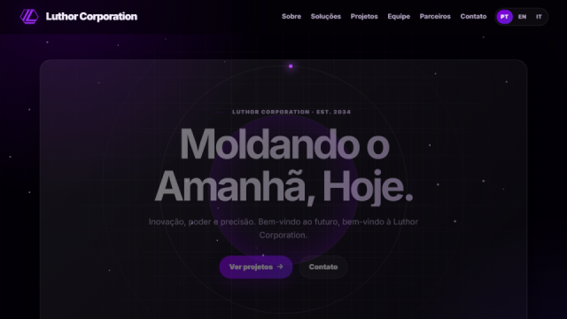
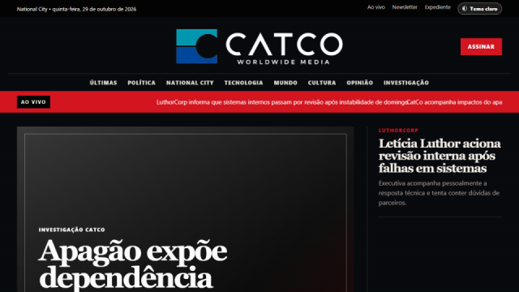
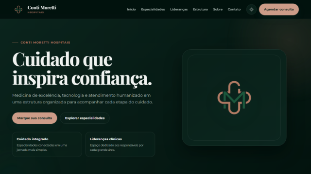
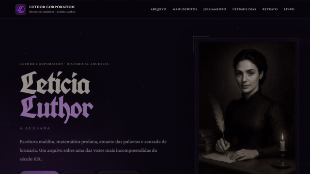

  

  

<h3 align="center">Hi, I'm Letícia 👋</h3>

  I build games, websites and stories set in my own Luthor Corp universe, from National City's newsroom
  to its hospitals and its CEO's penthouse. 
  Mostly <b>Python</b> and <b>JavaScript</b>, with a soft spot for pixel art.

  🗣️ <b>Languages I speak</b> 
  &nbsp; &nbsp; &nbsp; &nbsp; &nbsp; &nbsp; &nbsp; &nbsp; &nbsp;

<h2 align="center">⭐ Featured project</h2>

  
  <h3><a href="https://luthorw.github.io/Luthor-Life/">Luthor Life</a></h3>
  

    A cozy pixel-art life sim made in Python + pygame, inspired by Stardew Valley. 
    Run L-Corp as CEO Letícia Luthor, make friends, fish, cook, grow a garden and fall in love in National City.
  

  
  
  

<h2 align="center">🎮 Games</h2>

<table align="center">
  <tr>
    <td width="50%" valign="top" align="center">
       <b><a href="https://luthorw.github.io/Ecos-de-Argyra/">Ecos de Argyra</a></b> 
      A Wonder Woman–inspired browser adventure: explore the world beyond Themyscira, fight and build bonds.
    </td>
    <td width="50%" valign="top" align="center">
       <b><a href="https://luthorw.github.io/NaoPode/">Não Pode</a></b> 
      A Taboo-style party game: describe the word without saying the forbidden ones.
    </td>
  </tr>
  <tr>
    <td width="50%" valign="top" align="center">
       <b><a href="https://luthorw.github.io/Music-Master/">Music Master</a></b> 
      Can you name the song in half a second? 420 tracks, hints and streaks.
    </td>
    <td width="50%" valign="top" align="center">
       <b><a href="https://luthorw.github.io/dbdle/">DBDle</a></b> 
      A Wordle-style guessing game for Dead by Daylight killers and perks.
    </td>
  </tr>
</table>

<h2 align="center">🏢 The Luthor Corp universe</h2>

<table align="center">
  <tr>
    <td width="50%" valign="top" align="center">
       
       <b><a href="https://luthorw.github.io/LuthorCorp/">Luthor Corporation</a></b> 
      L-Corp's corporate site: technology, research and strategic projects.
    </td>
    <td width="50%" valign="top" align="center">
       
       <b><a href="https://luthorw.github.io/CatCo/">CatCo Worldwide Media</a></b> 
      National City's biggest news portal.
    </td>
  </tr>
  <tr>
    <td width="50%" valign="top" align="center">
       
       <b><a href="https://luthorw.github.io/CMHospitais/">Conti Moretti Hospitals</a></b> 
      A hospital network site: specialties, clinical leaders and appointments.
    </td>
    <td width="50%" valign="top" align="center">
       
       <b><a href="https://luthorw.github.io/The-Witch/">The Witch</a></b> 
      Historical archives on the writings, trial and legacy of Letícia Luthor, the accused.
    </td>
  </tr>
</table>

<h2 align="center">💗 Also made</h2>

   <b><a href="https://luthorw.github.io/Outubro-Rosa/">Outubro Rosa</a></b> 
  A breast cancer awareness campaign site for UNINOVE.

<h2 align="center">⚒️ Languages · Frameworks · Tools</h2>

   
    
  

<h2 align="center">🌐 Connect with me</h2>

  <h2>🐍 My contributions</h2>
  

  
  &nbsp;&nbsp;&nbsp;&nbsp;
  
    
  
Partner of AC Milan and FC Barcelona.

